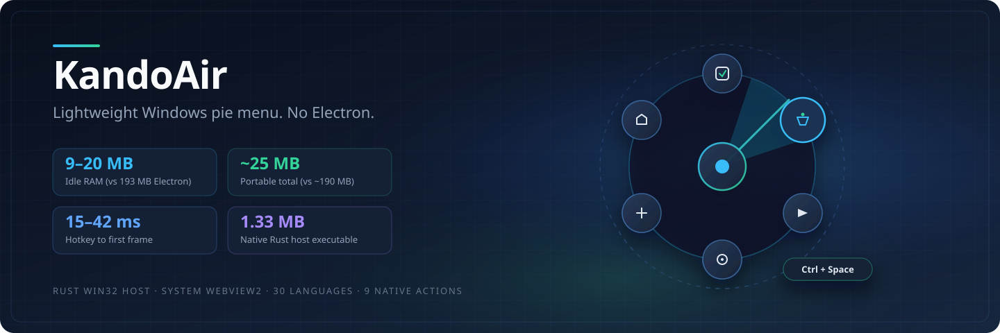

<!--
SPDX-FileCopyrightText: Simon Schneegans <code@simonschneegans.de>
SPDX-FileCopyrightText: KandoAir contributors
SPDX-License-Identifier: CC-BY-4.0
-->

<!-- project:start -->
# KandoAir

A lightweight, Windows-only pie menu based on Kando 3.0.1. It replaces the Electron runtime with a 1.33 MB native Rust host and the system WebView2, cutting idle memory by ~90% and package size by ~7.6× while keeping the signature radial menu, themes, and settings editor.

**[Download v0.1.0](https://github.com/seiya058904/KandoAir/releases/latest)** · [Source](https://github.com/seiya058904/KandoAir)
<!-- project:end -->

<p align="center">
  <a href="https://github.com/seiya058904/KandoAir/releases/latest">
    
  </a>
</p>

<div align="center">

<h2>🌀 The Pie Menu Without the Electron Tax</h2>

<p><strong>1.33 MB native Rust host. 9–20 MB idle memory. 15–42 ms from hotkey to first frame.</strong></p>

<p>Keeps Kando's fluid marking mode, themes, sound effects, and visual menu editor,<br>
stripped of Electron, background servers, achievements, and cross-platform bloat.</p>

<p>
  <a href="https://github.com/seiya058904/KandoAir/releases/latest"></a>
  
  
  
  <a href="LICENSE.md"></a>
</p>

<p>
  <a href="https://github.com/seiya058904/KandoAir/releases/latest"><strong>⬇ Download for Windows</strong></a>
  &nbsp;·&nbsp;
  <a href="#why-kandoair">⚡ KandoAir vs. Kando</a>
  &nbsp;·&nbsp;
  <a href="#highlights">✨ Highlights</a>
  &nbsp;·&nbsp;
  <a href="#download">📦 Get Started</a>
  &nbsp;·&nbsp;
  <a href="#usage">🖱️ Usage</a>
  &nbsp;·&nbsp;
  <a href="#how-it-works">🛠️ How It Works</a>
</p>

<p><sub>NATIVE RUST HOST &nbsp;·&nbsp; SYSTEM WEBVIEW2 &nbsp;·&nbsp; 30 LANGUAGES &nbsp;·&nbsp; 9 NATIVE ACTIONS &nbsp;·&nbsp; PORTABLE &nbsp;·&nbsp; NO ELECTRON</sub></p>

</div>

---

> **No Electron. No Node.js. No 200 MB background footprint.**
>
> Unzip and run `KandoAir.exe`. When the menu is hidden, KandoAir trims and suspends its WebView2 instance down to **9–20 MB**; when you close Settings, its browser processes exit completely and release their memory.

> [!NOTE]
> KandoAir is an unofficial, Windows-only derivative based on **[Kando 3.0.1](https://github.com/kando-menu/kando)** by Simon Schneegans. It is not affiliated with or endorsed by the Kando project.

<a id="why-kandoair"></a>
## ⚡ Why KandoAir? (vs. Original Kando 3.0.1)

Original Kando ships a full **Electron (Node.js + Chromium)** runtime so it can run across Windows, macOS, and Linux. On Windows, that means carrying ~190 MB of binaries and keeping ~193 MB of RAM resident in the tray even when you are not using the menu — and memory stays elevated after closing Settings.

**KandoAir** keeps the exact pie-menu experience and replaces the entire Electron backend with a **1.33 MB native Rust Win32 host** driving the **Windows system WebView2**.

### 📊 Measured Performance & Footprint

Measured on the same Windows 11 machine for the entire process tree (`scripts/measure.ps1`):

| Metric | Kando 3.0.1 (Electron) | KandoAir (Rust + WebView2) | Improvement |
| :--- | :--- | :--- | :--- |
| **Download / package size** | ~190 MB | **~25 MB** (`1.33 MB` exe) | **~7.6× smaller** |
| **Idle in tray (Private Working Set)** | 193 MB | **9–20 MB**¹ | **~90% less RAM** |
| **Idle in tray (Private Bytes)** | 326 MB | **180–285 MB** | **Up to 45% lower** |
| **Settings window open (Working Set)** | 475 MB | **~350 MB** | **~125 MB lighter** |
| **After closing Settings** | 325 MB (stays bloated) | **Back to 9–20 MB within 15 s** | **Full memory release** |
| **Idle CPU usage** | 0% | **0%** | **Zero background wakeups** |
| **Hotkey to first rendered frame** | — | **15–42 ms** | **Instant wake from suspend** |

<sub>¹ Measured 30–60 s after hiding the menu; immediately after hiding, it sits around ~80 MB before Windows/WebView2 trims and suspends it.</sub>

### ✂️ Leaner, Cleaner, Less Bloat

KandoAir deliberately strips away cross-platform layers and non-essential extras so every megabyte and millisecond counts:

| Area | Kando 3.0.1 | KandoAir |
| :--- | :--- | :--- |
| **Runtime** | Electron (Node.js + bundled Chromium) | **Native Rust host** (`windows` + `webview2-com`) + **system WebView2** |
| **Platforms** | Windows, macOS, Linux | **Windows 10 / 11 (x64)** — zero cross-platform abstraction tax |
| **Actions** | Multi-step workflows (14 action types) | **9 crisp single-step native actions** (faster config, simpler UI) |
| **Removed bloat** | Achievements, WebSocket API, auto-updater, gamepad/pen backends | **Removed** — no gamification popups, no local WebSocket server, no update polling |
| **Kept intact** | Pie menu, marking/turbo mode, themes, sound themes, conditions, 30 locales | **100% preserved** — plus seamless import of Kando 3.x `menus.json` backups |

### 🧭 Which One Should You Choose?

- **Choose KandoAir if** you are on **Windows 10/11**, want a **lightweight, portable, ~25 MB** launcher that sits quietly at **~10–20 MB RAM** in your tray, opens in **15–42 ms**, and doesn't leave hundreds of megabytes of Electron processes running all day.
- **Stick with upstream Kando if** you need **macOS/Linux** support, **gamepad/stylus** input, **multi-step chained workflows**, **achievements**, or the **WebSocket API**.

<a id="highlights"></a>
## ✨ Highlights

<table>
  <tr>
    <td width="50%" valign="top">
      <h3>🦀 Native Rust Win32 Host</h3>
      <p><sub>1.33 MB EXECUTABLE · ZERO NODE.JS</sub></p>
      <p>Tray icon, global hotkeys, window detection, icon extraction, and action execution all run in pure Rust on Win32 APIs — no Electron main process, no Node.js runtime.</p>
    </td>
    <td width="50%" valign="top">
      <h3>💤 Suspend-on-Hide &amp; Isolated Settings</h3>
      <p><sub>9–20 MB IDLE · FULL RELEASE ON CLOSE</sub></p>
      <p>When hidden, the menu WebView2 is trimmed and suspended, waking in 15–42 ms on hotkey. Settings runs in its own WebView2 process group that exits completely when closed.</p>
    </td>
  </tr>
  <tr>
    <td width="50%" valign="top">
      <h3>🎯 9 Native Single-Step Actions</h3>
      <p><sub>FAST EXECUTION · ZERO WORKFLOW OVERHEAD</sub></p>
      <p>Launch App, Open File/Folder, Open URL, Simulate Hotkey, Run Command, Set Clipboard, Execute Macro, Focus Window, and Open Menu — all executed natively from Rust.</p>
    </td>
    <td width="50%" valign="top">
      <h3>🖱️ Marking, Turbo &amp; Quick-Select</h3>
      <p><sub>MUSCLE-MEMORY GESTURES · KEYBOARD NAVIGATION</sub></p>
      <p>Click items, drag straight through submenus in marking mode, hold a modifier for turbo mode, or trigger items with quick-select keys. <kbd>Backspace</kbd> goes back, <kbd>Esc</kbd> closes.</p>
    </td>
  </tr>
  <tr>
    <td width="50%" valign="top">
      <h3>🎨 Themes &amp; Sound Effects</h3>
      <p><sub>5 BUNDLED THEMES · CUSTOM THEMES · WEB AUDIO</sub></p>
      <p>Includes <code>Default</code>, <code>Clean Circle</code>, <code>Neon Lights</code>, <code>Purity</code>, and <code>Rainbow Labels</code>, custom menu themes, light/dark color presets, and bundled/custom sound themes.</p>
    </td>
    <td width="50%" valign="top">
      <h3>🪟 Smart Conditions &amp; CJK Hotkey</h3>
      <p><sub>APP/TITLE/SCREEN RULES · IME-SAFE</sub></p>
      <p>Bind menus to specific apps, window titles, or screen regions. If a CJK IME claims <kbd>Ctrl</kbd>+<kbd>Space</kbd>, KandoAir automatically falls back to <kbd>Ctrl</kbd>+<kbd>Alt</kbd>+<kbd>Space</kbd>.</p>
    </td>
  </tr>
  <tr>
    <td width="50%" valign="top">
      <h3>🌐 30 Languages</h3>
      <p><sub>FULL LOCALIZATION · KANDO 3.X IMPORT</sub></p>
      <p>Includes all 30 interface translations and the interactive tutorial. Import existing Kando 3.x menus directly from Settings (workflows automatically map to their first supported action).</p>
    </td>
    <td width="50%" valign="top">
      <h3>🎒 Portable &amp; CLI-Ready</h3>
      <p><sub>NO INSTALLER REQUIRED · SCRIPT-FRIENDLY</sub></p>
      <p>Drop a <code>portableMode.json</code> next to <code>KandoAir.exe</code> to keep all config self-contained, or control a running instance via <code>--settings</code> and <code>--menu "&lt;name&gt;"</code>.</p>
    </td>
  </tr>
</table>

## 🎬 In Action

<p align="center">
  
</p>

<a id="download"></a>
## 📦 Download & Quick Start

**[Get the latest release →](https://github.com/seiya058904/KandoAir/releases/latest)**

| Current release · v0.1.0 | Download |
| :--- | :--- |
| **Windows x64 portable archive** | [KandoAir-v0.1.0-win-x64.zip](https://github.com/seiya058904/KandoAir/releases/download/v0.1.0/KandoAir-v0.1.0-win-x64.zip) |
| **File integrity** | [SHA256SUMS.txt](https://github.com/seiya058904/KandoAir/releases/download/v0.1.0/SHA256SUMS.txt) |

### Requirements

- **Windows 10 or 11 (x64)** (tested on Windows 11 23H2+)
- **[Microsoft Edge WebView2 Runtime](https://developer.microsoft.com/microsoft-edge/webview2/)** (pre-installed on Windows 11)

### Quick Start

1. Download and extract `KandoAir-v0.1.0-win-x64.zip` into any folder, then run `KandoAir.exe`.
2. Press <kbd>Ctrl</kbd>+<kbd>Space</kbd> (or <kbd>Ctrl</kbd>+<kbd>Alt</kbd>+<kbd>Space</kbd> if a CJK IME uses <kbd>Ctrl</kbd>+<kbd>Space</kbd>) to open the example pie menu.
3. Right-click the tray icon to open **Settings**, pause shortcuts, or quit.

<details>
<summary><strong>🛡️ Unsigned binary &amp; SHA-256 verification</strong></summary>

`KandoAir.exe` is **not code-signed**, so Windows SmartScreen may show a prompt on first launch. Download from the official release page and verify the archive against `SHA256SUMS.txt`:

```powershell
Get-FileHash .\KandoAir-v0.1.0-win-x64.zip -Algorithm SHA256
```

</details>

<a id="usage"></a>
## 🖱️ Usage, CLI & Config

### Command Line (forwarded to a running instance)

- `KandoAir.exe --settings` — open the Settings window.
- `KandoAir.exe --menu "<name>"` — open the menu with the given name.
- `KandoAir.exe --config-dir <dir>` — use a custom config directory.

### Config & Portable Mode

- Default config location: `%APPDATA%\KandoAir` (`config.json`, `menus.json`); caches and logs live in `%LOCALAPPDATA%\KandoAir`.
- **Portable mode**: place a `portableMode.json` file next to `KandoAir.exe` containing `{ "configDirectory": "<dir>" }` to keep all settings self-contained.
- **Migrating from Kando 3.x**: click **Import menu** in Settings or restore a Kando `menus.json` backup. Multi-step workflows are automatically converted to each item's first supported native action.

<a id="how-it-works"></a>
## 🛠️ How It Works

- **Single-threaded Win32 UI loop + worker threads**: `host/` (`windows` + `webview2-com`, no async runtime) manages the tray icon, global hotkeys, and window lifecycle on one message loop, offloading blocking work to worker threads.
- **Virtual hosts (no local HTTP server)**: the frontend is served directly from `app.kandoair.example` (`resources/web`), `user.kandoair.example` (config dir), and `sys.kandoair.example` (system/app icons and local images).
- **Aggressive idle trimming**: hiding the menu suspends its WebView2 instance so idle RAM drops to **9–20 MB**; opening Settings spawns an isolated WebView2 process tree that exits completely when the window closes.

<details>
<summary><strong>⚙️ Build from source &amp; run checks</strong></summary>

### Requirements

- Node.js 22+
- Rust (MSVC toolchain)
- Visual Studio Build Tools with the Windows SDK

```powershell
npm ci
npm run build          # builds dist\KandoAir (web frontend + release host)
```

### Development

```powershell
npm run watch:web                        # rebuilds dist\web on changes
$env:KANDOAIR_WEB_DIR = "$PWD\dist\web"  # use the development frontend
$env:KANDOAIR_DEBUG_PORT = "9222"        # optional: WebView2 remote debugging (CDP)
cargo run --manifest-path host/Cargo.toml -- --config-dir "$env:TEMP\kandoair-dev"
```

### Checks & Benchmark

```powershell
npm run lint; npm run tscheck; npm test
cargo test --manifest-path host/Cargo.toml
cargo clippy --manifest-path host/Cargo.toml --all-targets -- -D warnings
./scripts/measure.ps1 -Name KandoAir -Seconds 60   # memory and CPU of the process tree
```

</details>

## 🙏 Credits & License

KandoAir is built on the work of [Simon Schneegans](https://github.com/Schneegans) and all contributors of [Kando](https://github.com/kando-menu/kando).

Like Kando, KandoAir follows the [REUSE specification](https://reuse.software/):
- Source code is licensed under the **MIT License** ([LICENSE.md](LICENSE.md)).
- Documentation and assets are licensed under the licenses in [`LICENSES`](LICENSES) as annotated in each file or `REUSE.toml`.
- Kando icons are licensed under **CC-BY-4.0** (Simon Schneegans, Bingies24).

---

<p align="center">
  <sub>NATIVE RUST HOST. SYSTEM WEBVIEW2. ZERO ELECTRON TAX.</sub><br>
  <sub>KandoAir · Lightweight pie menu for Windows.</sub>
</p>
